# 交付说明

本文说明「N2 桌面」的目录结构、构建与验证命令、安装与使用步骤，以及已知限制。命令均在仓库根目录执行（Windows PowerShell）。

## 目录结构

```text
OemLauncher/
├─ shared/                            两端共用的纯 Kotlin 契约（不依赖 Android）
│  └─ src/main/kotlin/com/n2/oemlauncher/shared/
│     ├─ model/                       数据模型：应用键、目录、配置、布局设置、手表状态
│     ├─ config/                      默认值与清洗：LauncherDefaults、ConfigSanitizer、ConfigEditor
│     ├─ ordering/                    排序规则：AppOrdering（常用/隐藏/排序模式 → 最终顺序）
│     ├─ protocol/                    同步协议：路径与键、gzip 编解码、IconId、修订号策略、状态解析
│     └─ layout/                      蜂窝几何：螺旋、鱼眼透镜、投影、命中测试、边界、圆屏裁剪
├─ wear/                              Wear OS 启动器（主产品）
│  └─ src/main/kotlin/com/n2/oemlauncher/wear/
│     ├─ catalog/                     LauncherApps 目录查询与监听、图标解码缓存、应用启动
│     ├─ data/                        DataStore 配置与统计、目录快照、图标文件、同步状态存储
│     ├─ domain/                      目录 + 配置 → 可直接渲染的条目
│     ├─ input/                       表冠旋转适配与触觉反馈
│     ├─ sync/                        Data Layer：目录发布、desired 处理、state 回执、Tile 刷新通知
│     ├─ tile/                        常用应用 Tile 的模型、布局与服务
│     ├─ ui/                          Compose 界面：三种布局、长按菜单、设置与主题
│     └─ config/                      本模块常量（WearConstants）
├─ mobile/                            手机配套 App
│  └─ src/main/kotlin/com/n2/oemlauncher/mobile/
│     ├─ data/                        仓库与持久化：快照、图标内容寻址存储、演示目录工厂
│     ├─ editor/                      草稿历史（撤销/重做）、ViewModel 状态与导入会话
│     ├─ iconpack/                    ZIP 安全解压、图片裁剪与归一化、appfilter 解析、导入仓库
│     ├─ sync/                        WearGateway 抽象与实现、desired 构建、catalog/state 接收
│     ├─ ui/                          Compose 界面
│     │  ├─ screens/                  各页面：首页、编辑器、预览、外观、图标、裁剪、导入结果、帮助、同步诊断
│     │  ├─ components/               复用组件：预览渲染器、应用行、状态色调、相对时间、错误文案
│     │  ├─ navigation/               类型安全路由与 Scaffold/顶栏
│     │  └─ theme/                    配色、动态色与系统栏
│     └─ config/                      本模块常量（MobileConstants）
├─ docs/                              架构说明、同步协议与本文档
└─ gradle/                            版本目录（libs.versions.toml）与 wrapper
```

两端测试源码分别位于 `wear/src/test/` 与 `mobile/src/test/`，包结构与主源码一一对应。模块根目录下分别是应用入口与手写依赖容器：`wear` 的 `App.kt`、`AppContainer.kt`、`MainActivity.kt`，以及 `mobile` 的 `CompanionApplication.kt`、`AppContainer.kt`、`MainActivity.kt`。

## 构建与验证

### 单元测试与调试包

```powershell
.\gradlew.bat :shared:test :wear:testDebugUnitTest :mobile:testDebugUnitTest assembleDebug
```

产物：

- `wear\build\outputs\apk\debug\wear-debug.apk`
- `mobile\build\outputs\apk\debug\mobile-debug.apk`

### Lint

```powershell
.\gradlew.bat :wear:lintDebug :mobile:lintDebug
```

### Release（开启 R8 与资源压缩）

```powershell
.\gradlew.bat assembleRelease
```

产物：`wear\build\outputs\apk\release\wear-release.apk`、`mobile\build\outputs\apk\release\mobile-release.apk`。

### 签名与 keystore.properties

仓库根目录可选放一个 `keystore.properties`，格式如下（`storeFile` 相对仓库根目录）：

```properties
storeFile=keystore.jks
storePassword=<store 密码>
keyAlias=<key 别名>
keyPassword=<key 密码>
```

没有该文件时，release 构建自动回退到 debug 签名。这是刻意行为：Data Layer 要求两端包名与签名一致，本地开发用同一把 debug 签名即可让两个 release 包互通。

## 安装与使用

### 手表端

```powershell
adb -s <手表序列号> install -r wear\build\outputs\apk\debug\wear-debug.apk
```

把上面路径里的 `debug` 换成 `release` 即可安装 release 包（开启 R8 与资源压缩，冷启动更快）。

设为默认主屏（是否允许替换取决于系统与厂商）：

```powershell
adb -s <手表序列号> shell cmd package set-home-activity com.n2.oemlauncher/com.n2.oemlauncher.wear.MainActivity
```

添加 Tile：在手表上从表盘向左滑到 Tile 轮播，用“编辑/添加”选择“N2 常用应用”（英文界面为 “N2 Favorites”）。开发机（模拟器）上也可以用系统调试广播直接添加：

```powershell
adb -s <手表序列号> shell am broadcast -a com.google.android.wearable.app.DEBUG_SURFACE --es operation add-tile --ecn component com.n2.oemlauncher/com.n2.oemlauncher.wear.tile.FavoritesTileService
adb -s <手表序列号> shell am broadcast -a com.google.android.wearable.app.DEBUG_SYSUI --es operation show-tile --ei index 0
```

操作方式：

- 长按图标（三种布局均可）打开菜单：切换常用、隐藏应用、打开系统应用信息。
- 旋转表冠：蜂窝布局逐格居中，网格与列表滚动（真机上带触觉反馈）。模拟器上注入旋转事件要用带轴的写法 `adb -s <序列号> shell input rotaryencoder scroll --axis SCROLL,2`，不带 `--axis` 的旧写法送进应用的是 0，看不到效果。
- 设置入口：蜂窝布局在底部焦点名下方（图标进入底部信息带前会淡出，不会被遮住）；网格与列表里是内容的最后一项，滚到底即可看到，因此任何滚动位置都不会遮挡图标或标签。
- 设置页：调整布局模式、图标大小与形状、排序模式、标签、吸附、触觉与减弱动画；常用应用顺序也可在设置页调整；底部显示同步状态、上次同步时间与最近一次结果。

### 手机端

```powershell
adb -s <手机序列号> install -r mobile\build\outputs\apk\debug\mobile-debug.apk
```

- 没有手表时：首页点“Try the demo”进入演示模式（40 个示例应用），或直接点“Refresh watch”等待连接。
- 编辑：首页“布局编辑”进入编辑器；搜索、排序模式、星标常用、拖拽或行尾菜单排序、隐藏应用；所有改动自动保存并可撤销/重做。
- 预览：点首页缩略图进入全屏预览，可拖动探索；预览按手表真实分辨率与密度绘制，与手表使用同一套算法。
- 外观：首页“外观”调整布局模式、图标大小与形状、鱼眼强度、网格列数、标签、吸附、触觉与减弱动画。
- 图标：首页“图标”为单个应用选择照片并裁剪（192 px PNG），或导入 ZIP 图标包（包名图片或 `appfilter.xml`）；导入先预览匹配结果，确认后应用，可随时恢复默认。
- 同步与诊断：首页同步卡片显示阶段与冲突处理（“载入手表配置”或“用我的修改覆盖”）；“同步诊断”页显示节点能力、收发时间、发送修订与结果、缺失图标与最近 API 错误，并提供“重新请求目录”与“重新发送”。

### 配对与同步的前提

- 两端 `applicationId` 必须一致（都是 `com.n2.oemlauncher`），签名也必须一致，否则 Data Layer 无法建立通道。
- 手表通过其 Wear OS 配套应用与手机配对，两端都需安装并启用 Google Play 服务。
- 配好后打开一次手表端应用，然后在手机首页点“Refresh watch”即可拉取目录。

## 已知限制

- **Data Layer 未在配对真机上端到端验证**：开发用的两台模拟器未配对、无 Wear OS 配套应用，catalog/state/desired 的真实往返、Asset 文件描述符读取与拒绝回执关联修订号都只经过假实现单测与静态检查，真机配对后需做一次完整回归。
- **模拟器性能数据只作参考**：模拟器使用软件渲染（swiftshader），帧率与滚动数据不能代表真机；功耗与流畅度需在真机确认。
- **能否替换系统主屏取决于手表厂商**：部分手表不允许第三方应用成为默认主屏；此时使用 Tile 或应用图标入口，功能不受影响。
- **表冠手感需真机复验**：旋钮输入已通过 Compose `onRotaryScrollEvent` 接入三种布局，模拟器上用 `input rotaryencoder scroll --axis SCROLL,2` 可以复现（蜂窝焦点移动、列表滚动均已实测截图）；但滚动步进与触觉手感仍需在带旋钮的真机上确认。
- **切换主题会清空进行中的 ZIP 导入预览**：导入是会话态，切换深浅色重建页面后需重新选择 ZIP；已应用的图标不受影响。
- **旧版手机（不写 `SyncKeys.REVISION`）的 schema/解码拒绝无法关联修订号**：此时手表保持 `lastDesiredRevision` 不变（协议允许的降级）；新版手机写入该键后拒绝回执可正确关联。
- **DataStore 读取失败时手表以空状态继续启动**：为保证冷启动不被阻塞，此时收到 desired 会按空状态处理。
- **Tile 只显示前 4 个常用**：启动器本身仍是 7 个常用，Tile 上限是设计常量（`WearConstants.TILE_FAVORITES_MAX`）。
- **构建缓存注意事项**：开发过程中曾出现构建缓存产物导致安装后启动缺类（`NoClassDefFoundError`），最终安装前的构建建议加 `--no-build-cache`；如遇同类症状，先 `clean` 后重建再判定。
- **无障碍自定义操作需真机确认**：手机编辑器的“上移/下移”通过 `customActions` 提供，`uiautomator dump` 不呈现自定义操作，端到端体验需在 TalkBack 或真机无障碍服务下确认。
- **手表蜂窝的逐图标语义节点只在停稳后生成**：拖动过程中语义树为空，松手（或表冠步进）后才重建，这是为了避免逐帧分配；如需拖动中也可读，需要另设节流刷新策略。
- **演示数据开关仅 debug 包可见**：`demo_data` 受 `BuildConfig.DEBUG` 限制，release 包里没有该入口（不影响正常使用）。

## 测试与验证结果

以下数据来自一次完整的本地验证（`--no-build-cache` 全量构建 + 两台模拟器实测）。

### 构建与单测

```powershell
.\gradlew.bat :shared:test :wear:testDebugUnitTest :mobile:testDebugUnitTest assembleDebug assembleRelease :wear:lintDebug :mobile:lintDebug --no-build-cache
```

| 模块 | 单测 | 失败 | Lint |
| --- | --- | --- | --- |
| `shared` | 46 | 0 | 不适用（纯 Kotlin 模块） |
| `wear` | 63 | 0 | 0 error / 2 warning（`ObsoleteSdkInt`、`WearRecents`，均为历史遗留） |
| `mobile` | 63 | 0 | 0 error / 0 warning（No issues found） |

`assembleDebug` 与 `assembleRelease` 均成功，四个 APK 全部产出。release 包体积：

| 包 | 大小 |
| --- | --- |
| `wear\build\outputs\apk\release\wear-release.apk` | 2.74 MB（2807 KB） |
| `mobile\build\outputs\apk\release\mobile-release.apk` | 2.21 MB（2265 KB） |

### Release 冷启动（`am start -W`，先 `am force-stop`，各 3 次）

| 设备 | 第 1 次 | 第 2 次 | 第 3 次 |
| --- | --- | --- | --- |
| 手机 `emulator-5556` | 3092 ms | 3102 ms | 3160 ms |

刚装完包后的头几次冷启动包含安装后的 profile 编译，会明显偏慢；同一次会话里继续测量可以降到 2.4 s 左右（实测 2492 / 2381 / 2463 ms）。但这项数据受模拟器负载影响很大：同一时段系统自带“设置”应用的冷启动是 4077–4971 ms，模拟器负载均值达到 7.28，因此这组数字只适合同一时段内部比较，不能与更早的测量直接对比。

> 模拟器使用软件渲染（swiftshader），上述耗时与帧率数据只作功能验证参考，不代表真机性能。

### 实测走过的流程

手表端（`wear` 的 release 包，并设为默认主屏，应用语言为简体中文）：

- 按 Home 直接回到启动器；蜂窝布局下点击**非中心**图标成功启动对应应用。
- 长按图标打开菜单，四个操作（常用 / 隐藏 / 信息 / 取消）都可点击，菜单完整落在圆屏安全区内。
- 三种布局切换正常：蜂窝（鱼眼 + 焦点名 + 设置胶囊）、网格（正圆图标、均匀行距、完整标签）、列表（`TransformingLazyColumn` 缩放淡出）。
- 表冠：`adb shell input rotaryencoder scroll --axis SCROLL,2` 让蜂窝焦点逐格移动、列表逐行滚动（详见“已知限制”关于注入命令的说明）。
- 设置页：布局 / 图标大小 / 图标形状 / 排序 / 标签 / 吸附 / 触觉 / 减弱动画，以及同步状态区（状态、上次同步时间、最近结果）。
- Tile：`DEBUG_SURFACE` + `DEBUG_SYSUI` 添加并显示“N2 常用应用”，2×2 居中布局，图标与名称都在圆屏内，点击直启。

手机端（`mobile` 的 release 包，应用语言为简体中文）：

- 首页：演示模式（40 个示例应用，名称随应用语言生成中文）、缩略图、连接与同步状态区、四个入口。
- 编辑器：搜索（含拼音全拼与首字母）、排序模式、星标、行尾溢出菜单（上移 / 下移 / 隐藏 / 换图标）、撤销 / 重做。
- 预览：与手表同尺寸的圆屏预览，蜂窝 / 网格 / 列表三种模式切换，拖动可探索且鱼眼跟随。
- 外观：调整布局模式后预览实时更新；图标大小、形状、鱼眼、网格列数、标签、吸附、触觉、减弱动画均可改。
- 图标：单个应用换图（裁剪）与 ZIP 图标包导入入口。
- 同步诊断：节点能力、最近收发时间、缺失图标、最近一次 API 错误（按状态码显示本地化短语，如“手表未连接”），以及“重新请求目录”“重新发送”。
- 深浅色主题切换正常，深色下所有页面可读。

## 中文支持

- **界面跟随系统语言**：两端都提供英文（`res/values/`）与简体中文（`res/values-zh-rCN/`）两套资源，系统语言为简体中文时自动显示中文，否则显示英文。
- **单独设置手机应用的语言**：Android 13 及以上可在“设置 → 系统 → 语言 → 应用语言”里为本应用单独选择 English 或简体中文，不影响系统语言。
- **手表跟随手表系统语言**：Wear OS 6 的系统设置里没有应用语言入口，手表应用只能跟随手表系统语言；简体中文系统下界面为中文。
- **拼音搜索**：手机端的搜索框支持拼音全拼与首字母，例如 `dh` 或 `dianhua` 搜到“电话”、`lxr` 或 `lianxiren` 搜到“联系人”；多音字的所有读音都会建索引，任一读音都能命中。索引按当前目录构建，真实安装的中文应用（如微信）同样可以用 `wx` 搜到。
- **演示数据跟随应用语言**：切换应用语言后，演示模式的示例应用名与图标会自动重新生成；用户在演示里调过的常用与排序会保留。
- **繁体中文系统目前显示英文**：这是有意的决定——繁体资源的用词与简体差异较大，未做简体直转，避免出现用词不地道的中文。

## 截图

以下图片均来自上表的实测（手表 `emulator-5554`、手机 `emulator-5556`，均为简体中文界面）。

### 手表端


蜂窝布局：中心应用放大，常用应用带高亮圈，底部显示当前焦点名与“设置”入口。

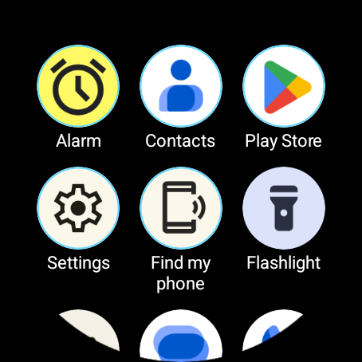

网格布局：图标保持正圆，标签完整显示，设置入口是列表最后一项，不会遮挡内容。

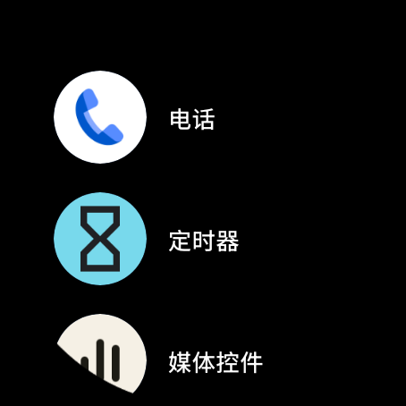

列表布局：基于 `TransformingLazyColumn`，边缘条目缩小淡出。

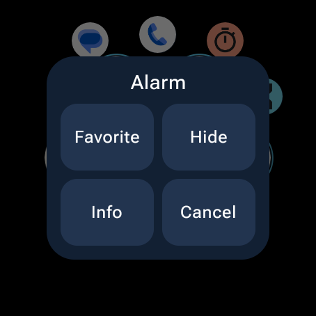

长按图标打开菜单，四个操作以 2×2 排布，完整落在圆屏安全区内。

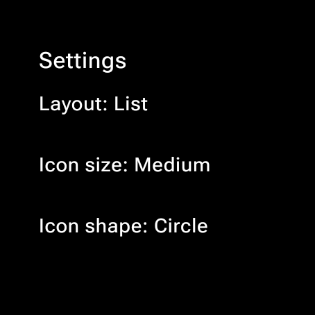

设置页：布局模式、图标大小与形状等外观选项。

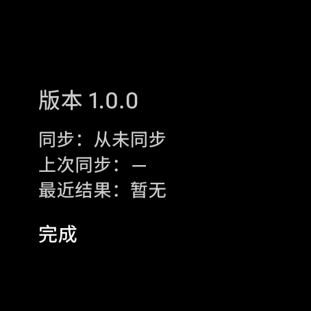

设置页底部的同步状态区：同步状态、按本地时间格式化的上次同步时间、最近一次同步结果。

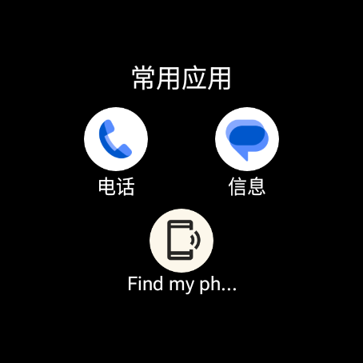

常用应用 Tile：2×2 居中布局，图标与名称都在圆屏内，点击直启。

### 手机端

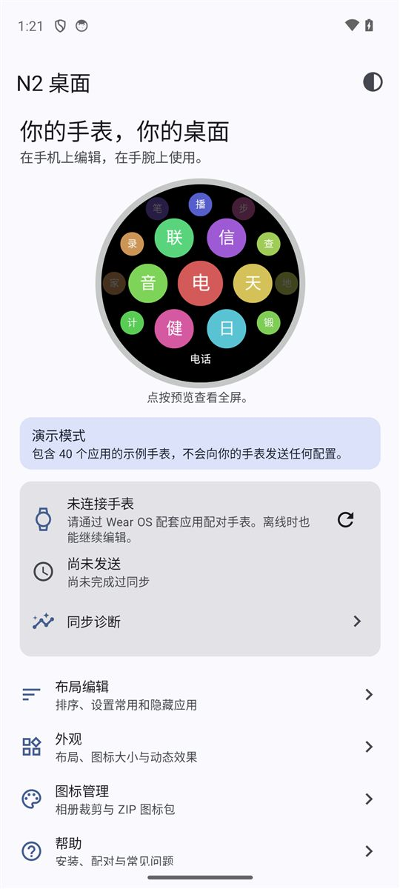

首页：演示模式下的中文示例应用、预览缩略图、连接与同步状态区，以及布局编辑、外观、图标、帮助四个入口。

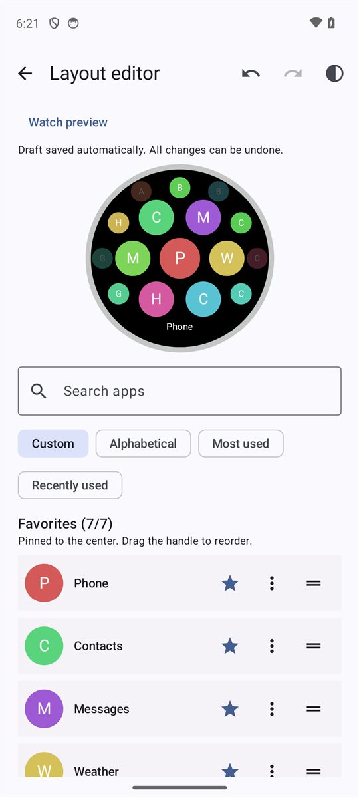

布局编辑器：搜索、排序模式、常用星标、行尾溢出菜单（上移 / 下移 / 隐藏 / 换图标）与撤销 / 重做。

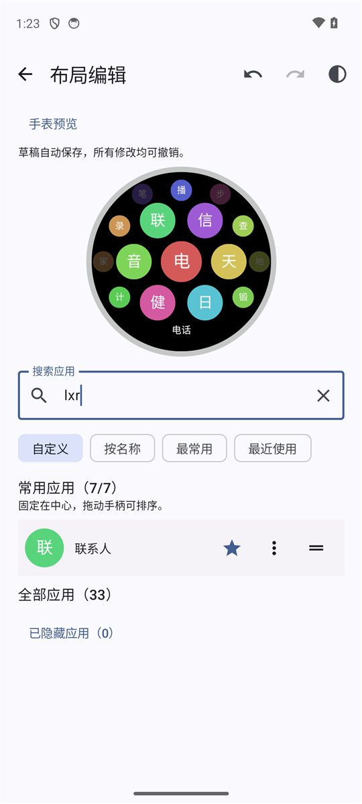

拼音搜索：搜索框输入首字母 `lxr`，结果只剩“联系人”，无需切换到中文输入法。

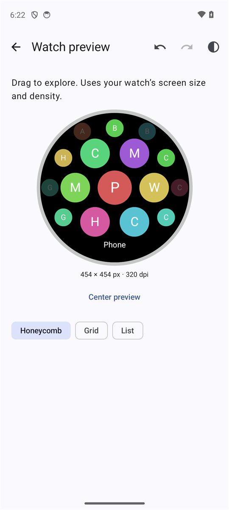

全屏预览：按手表真实分辨率与密度绘制，可拖动探索，与手表使用同一套蜂窝算法。

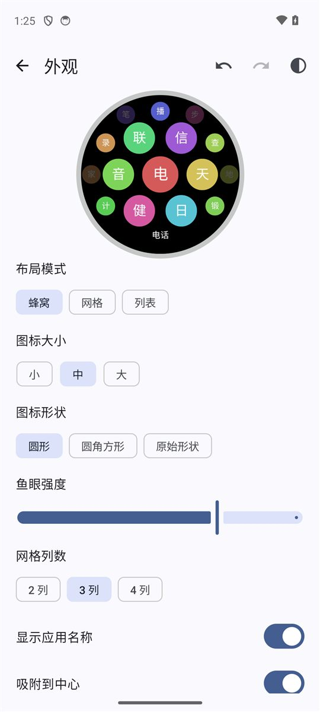

外观：调整布局模式、图标大小与形状、鱼眼强度、网格列数等，预览实时更新。

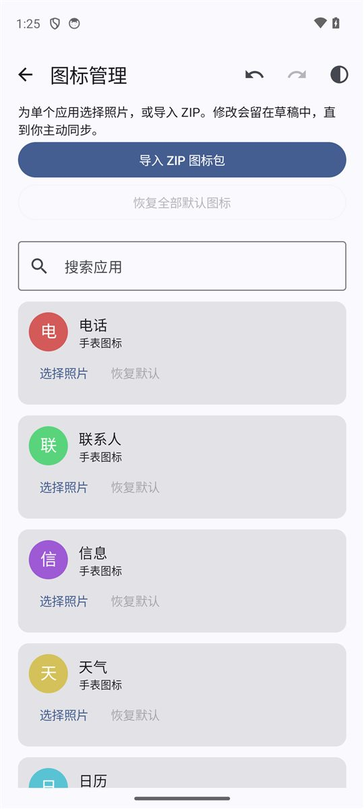

图标：为单个应用选择照片并裁剪，或导入 ZIP 图标包。

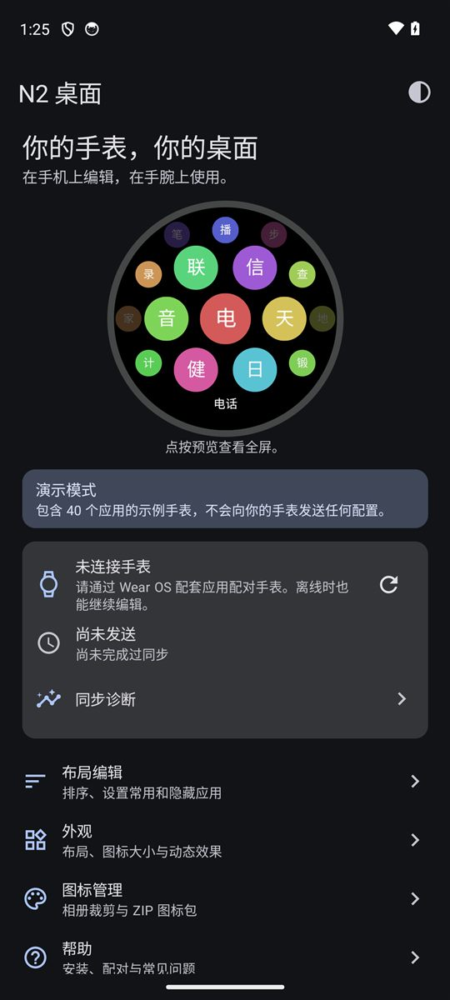

深色主题下的首页。

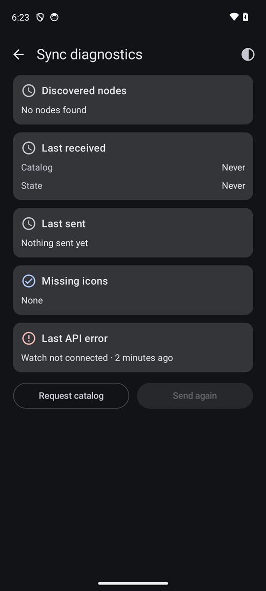

同步诊断：节点能力、最近收发时间、缺失图标、最近一次 API 错误（本地化短语），以及重新请求目录 / 重新发送。
